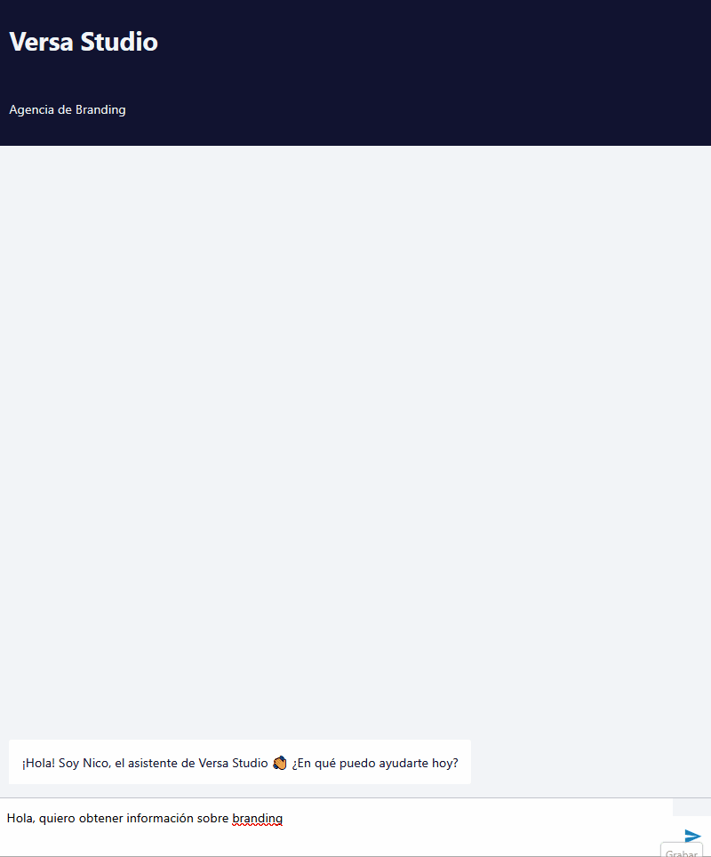

# 🤖 Versa Studio AI Agent

> Agente conversacional inteligente para cualificación de leads y agendamiento automático de citas

[](https://n8n.io)
[](https://supabase.com)
[](https://cloud.google.com/vertex-ai)
[](LICENSE)



---

## 📋 Descripción

**Nico** es un asistente virtual diseñado para Versa Studio (agencia de branding ficticia) que automatiza el proceso de captación de leads:

- 🗣️ **Conversación natural** - Cualifica leads de forma conversacional, no como formulario
- 📅 **Agendamiento inteligente** - Verifica disponibilidad y crea citas automáticamente
- 💾 **Persistencia completa** - Guarda leads y citas en base de datos relacional
- 🔄 **Flujo de estados** - Máquina de estados que guía la conversación

### ¿Por qué este proyecto?

Este proyecto demuestra cómo construir un **agente de IA funcional** que:
1. Integra un LLM (Gemini) con herramientas personalizadas
2. Persiste datos en una base de datos real
3. Maneja casos edge y conversaciones complejas
4. Tiene una arquitectura modular y mantenible

---

## 🎥 Demo


*Conversación completa: cualificación → agendamiento → confirmación*

---

## 🏗️ Arquitectura

```
┌─────────────────────────────────────────────────────────────────┐
│                         FRONTEND                                │
│                    n8n Chat Widget                              │
└─────────────────────────────┬───────────────────────────────────┘
                              │
                              ▼
┌─────────────────────────────────────────────────────────────────┐
│                      n8n WORKFLOW                               │
│                                                                 │
│  ┌─────────────┐    ┌─────────────┐    ┌─────────────────────┐ │
│  │ Chat Trigger│───▶│  AI Agent   │◀───│ Conversation Memory │ │
│  └─────────────┘    └──────┬──────┘    └─────────────────────┘ │
│                            │                                    │
│         ┌──────────────────┼──────────────────┐                │
│         ▼                  ▼                  ▼                │
│  ┌─────────────┐    ┌─────────────┐    ┌─────────────┐        │
│  │  DateTime   │    │    Slot     │    │  Database   │        │
│  │    Tool     │    │   Checker   │    │   Tools     │        │
│  └─────────────┘    └─────────────┘    └──────┬──────┘        │
│                                               │                │
└───────────────────────────────────────────────┼────────────────┘
                                                │
                              ┌─────────────────┴─────────────────┐
                              ▼                                   ▼
                    ┌─────────────────┐                ┌─────────────────┐
                    │     leads       │                │  appointments   │
                    │    (table)      │◀───────────────│    (table)      │
                    └─────────────────┘   foreign key  └─────────────────┘
                              │
                              │         SUPABASE
                    ┌─────────▼─────────┐
                    │  RPC Functions    │
                    │  (PostgreSQL)     │
                    └───────────────────┘
```

### Stack Tecnológico

| Capa | Tecnología | Justificación |
|------|------------|---------------|
| **Orquestación** | n8n | Visual workflow builder con soporte nativo para AI Agents |
| **LLM** | Google Vertex AI (Gemini 1.5) | Buen rendimiento en español, $300 créditos gratuitos |
| **Base de datos** | Supabase (PostgreSQL) | API REST automática, funciones PL/pgSQL, free tier generoso |
| **Memoria** | Window Buffer (n8n) | Mantiene contexto de los últimos 10 mensajes |

---

## 🔄 Máquina de Estados

El agente sigue un flujo conversacional definido en el System Prompt:

```
┌──────────┐     ┌───────────────┐     ┌──────────────────┐     ┌─────────────┐
│  SALUDO  │────▶│ CUALIFICACIÓN │────▶│ CONFIRMAR_INTERÉS│────▶│ AGENDAR_CITA│
└──────────┘     └───────────────┘     └────────┬─────────┘     └──────┬──────┘
                                                │                      │
                                                ▼                      ▼
                                        ┌─────────────┐        ┌──────────────┐
                                        │ OBJECIONES  │        │ CONFIRMACIÓN │
                                        └──────┬──────┘        └──────────────┘
                                               │
                                               ▼
                                        ┌─────────────┐
                                        │  DESPEDIDA  │
                                        └─────────────┘
```

### Datos recopilados

| Campo | Obligatorio | Validación |
|-------|-------------|------------|
| Nombre | ✅ | - |
| Empresa | ✅ | - |
| Email | ✅ | Formato válido |
| Necesidad | ✅ | - |
| Teléfono | ❌ | - |

### Reglas de negocio

- 📅 Horarios: L-V, 10:00-13:00 y 16:00-17:00
- ⏰ Mínimo 24h de antelación
- 🚫 No fines de semana
- 🔁 Solo 1 intento ante objeciones

---

## 📊 Modelo de Datos

```sql
-- Tabla de leads (contactos cualificados)
CREATE TABLE leads (
  id UUID PRIMARY KEY DEFAULT gen_random_uuid(),
  nombre TEXT NOT NULL,
  empresa TEXT NOT NULL,
  email TEXT NOT NULL UNIQUE,
  necesidad_principal TEXT NOT NULL,
  cualificado BOOLEAN DEFAULT false,
  session_id TEXT NOT NULL,
  created_at TIMESTAMPTZ DEFAULT NOW()
);

-- Tabla de citas
CREATE TABLE appointments (
  id UUID PRIMARY KEY DEFAULT gen_random_uuid(),
  lead_id UUID REFERENCES leads(id) ON DELETE CASCADE,
  fecha_hora TIMESTAMPTZ NOT NULL,
  duracion_minutos INTEGER DEFAULT 30,
  estado TEXT DEFAULT 'confirmada',
  created_at TIMESTAMPTZ DEFAULT NOW()
);

-- Función para crear cita vinculada (busca lead por email)
CREATE FUNCTION create_appointment_with_email(p_email TEXT, p_fecha_hora TIMESTAMPTZ)
RETURNS JSON AS $$
  -- Busca lead por email y crea appointment vinculado
$$ LANGUAGE plpgsql;
```

---

## 🚀 Instalación

### Prerrequisitos

- [Docker](https://docker.com) (para n8n local) o cuenta en [n8n Cloud](https://n8n.io)
- Cuenta en [Supabase](https://supabase.com) (gratis)
- Cuenta en [Google Cloud](https://cloud.google.com) con Vertex AI habilitado

### 1. Configurar Supabase

```bash
# 1. Crear proyecto en supabase.com
# 2. Ir a SQL Editor y ejecutar:
```

Ejecuta el contenido de [`database/schema.sql`](database/schema.sql)

### 2. Configurar Google Vertex AI

1. Crear proyecto en Google Cloud Console
2. Habilitar Vertex AI API
3. Crear Service Account con rol "Vertex AI User"
4. Descargar JSON de credenciales

### 3. Importar workflow en n8n

```bash
# Opción A: Docker local
docker run -it --rm -p 5678:5678 -v n8n_data:/home/node/.n8n n8nio/n8n

# Opción B: n8n Cloud
# Crear cuenta en n8n.io
```

1. Importar `workflow/versa-agent.json`
2. Configurar credenciales:
   - **Google Service Account**: JSON de GCP
   - **Header Auth (Supabase)**: Name=`apikey`, Value=tu anon key
3. Añadir headers en HTTP Request Tools:
   - `Authorization`: `Bearer {anon_key}`
   - `Content-Type`: `application/json`

### 4. Probar

1. Activar el workflow
2. Abrir la URL del Chat Trigger
3. ¡Conversar con Nico!

---

## 📁 Estructura del Proyecto

```
versa-studio-agent/
├── 📁 workflow/
│   └── versa-agent.json        # Workflow exportado de n8n
├── 📁 database/
│   └── schema.sql              # DDL completo de Supabase
├── 📁 docs/
│   ├── 📁 assets/
│   │   ├── demo-preview.gif    # GIF de la demo
│   │   ├── architecture.png    # Diagrama de arquitectura
│   │   └── supabase-tables.png # Screenshot de las tablas
│   ├── TECHNICAL.md            # Documentación técnica detallada
│   └── DECISIONS.md            # Decisiones de diseño y trade-offs
├── .gitignore
├── LICENSE
└── README.md                   # Este archivo
```

---

## 🧪 Casos de Prueba

| Escenario | Input | Comportamiento esperado |
|-----------|-------|------------------------|
| Happy path | Datos completos + confirma cita | Lead guardado, cita creada y vinculada |
| Fin de semana | "¿El sábado?" | Ofrece alternativa en día laborable |
| Email inválido | "mi email es hola" | Pide verificación de forma natural |
| Sin interés | "No me interesa" | Se despide sin insistir |
| Otro idioma | "Hello, I need branding" | Responde en español |
| Off-topic | "¿Qué tiempo hace?" | Redirige a la conversación |

---

## 📝 Lecciones Aprendidas

### 1. Los LLMs no garantizan orden de tools
> Si hay dependencias entre tools, hay que explicitarlo en el prompt. El agente no infiere que debe guardar el lead ANTES de crear la cita.

### 2. Code Tools devuelven strings, no objetos
> Los AI Agents de n8n esperan texto plano de los tools, no JSON. El LLM interpreta texto, no estructuras de datos.

### 3. Las funciones SQL simplifican workflows
> Mover lógica a PostgreSQL (vía RPC) reduce la complejidad del workflow. Una llamada HTTP en vez de dos.

### 4. El System Prompt es el 90% del trabajo
> Un prompt bien estructurado con reglas claras, ejemplos y edge cases evita horas de debugging.

---

## 🔮 Mejoras Futuras

- [ ] Integración con Google Calendar real
- [ ] Emails de confirmación automáticos
- [ ] Notificaciones por Slack/WhatsApp
- [ ] Multi-idioma (detección automática)
- [ ] Dashboard de métricas
- [ ] Rate limiting y autenticación

---

## 🤝 Contribuciones

Las contribuciones son bienvenidas. Por favor:

1. Fork el repositorio
2. Crea una rama (`git checkout -b feature/nueva-funcionalidad`)
3. Commit tus cambios (`git commit -m 'Añade nueva funcionalidad'`)
4. Push a la rama (`git push origin feature/nueva-funcionalidad`)
5. Abre un Pull Request

---

## 📄 Licencia

Este proyecto está bajo la licencia MIT. Ver [LICENSE](LICENSE) para más detalles.

---

## 👤 Autor

**Raúl Castellanos Sánchez** - [GitHub](https://github.com/CasteSan) | [LinkedIn](https://linkedin.com/in/rcastesan)

*Proyecto de demostración de n8n, agentes de IA con herramientas y arquitectura de software.*

---

<p align="center">
  <sub>Construido con ❤️ usando n8n, Supabase y Google Vertex AI</sub>
</p>
